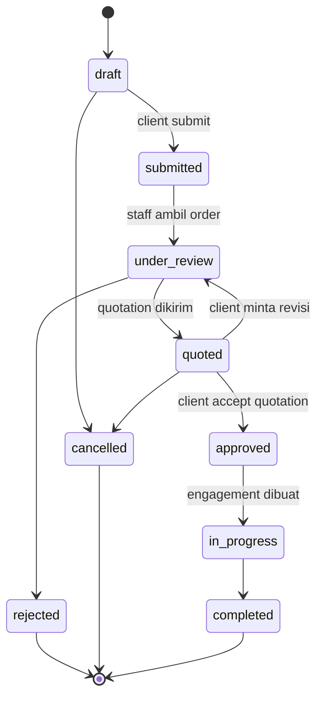

# Flexoo Service Order Dashboard: Database Design (ERD)

Dokumen ini berisi rancangan database untuk halaman **Service Order Dashboard** Flexoo Software House, diturunkan langsung dari mockup (Overview, Services & Catalog, Active Projects, Team & Sprints, Invoices & Retainers).

- **DBMS:** PostgreSQL
- **Primary key:** UUID (`gen_random_uuid()`)
- **Uang:** `BIGINT` dalam satuan Rupiah (tanpa desimal, menghindari floating point error)
- **Waktu:** `TIMESTAMPTZ`, disimpan dalam UTC, dikonversi ke timezone user di frontend
- **Soft delete:** kolom `deleted_at` di tabel master (users, clients, services)

---

## 1. Gambaran Domain

Sistem dibagi jadi 5 modul:

| Modul             | Tabel                                                                                                                              | Dipakai di UI                                                                                                                               |
| ----------------- | ---------------------------------------------------------------------------------------------------------------------------------- | ------------------------------------------------------------------------------------------------------------------------------------------- |
| Identity & Client | `users`, `clients`, `client_members`, `staff_profiles`                                                                             | Header (Yae, VP of Engineering), badge Horizon AI                                                                                           |
| Service Catalog   | `service_categories`, `services`, `technologies`, `service_technologies`                                                           | Section "Service Catalog & Capabilities", tab filter, tag tech stack                                                                        |
| Ordering (inti)   | `service_orders`, `order_status_histories`, `order_quotations`                                                                     | Tombol Request New Squad, Request Squad Expansion, Add to Retainer, Request Scope, Schedule Audit, Provision Team                           |
| Delivery          | `service_engagements`, `squads`, `squad_members`, `projects`, `sprints`, `user_stories`, `releases`, `project_metrics`, `meetings` | Card Sprint Progress, Staff Principal & Lead, metrik Cluster Latency / CI/CD / Coverage / Target Release, status badge di tiap service card |
| Billing           | `retainers`, `retainer_usages`, `invoices`, `invoice_items`, `payments`                                                            | Card Budget Allocation, Burn Rate, menu Invoices & Retainers                                                                                |
| Lainnya           | `notifications`                                                                                                                    | Icon notifications                                                                                                                          |

---

## 2. ERD

```mermaid
erDiagram
    users ||--o{ client_members : "tergabung di"
    clients ||--o{ client_members : "punya anggota"
    users ||--o| staff_profiles : "punya profil staff"

    service_categories ||--o{ services : "mengelompokkan"
    services ||--o{ service_technologies : "memakai"
    technologies ||--o{ service_technologies : "dipakai di"

    clients ||--o{ service_orders : "membuat"
    users ||--o{ service_orders : "requested_by"
    services ||--o{ service_orders : "dipesan"
    retainers ||--o{ service_orders : "dibebankan ke"
    squads ||--o{ service_orders : "target ekspansi"
    service_orders ||--o{ order_status_histories : "riwayat status"
    service_orders ||--o{ order_quotations : "penawaran"
    service_orders ||--o| service_engagements : "menghasilkan"

    clients ||--o{ service_engagements : "berlangganan"
    services ||--o{ service_engagements : "di-engage"
    retainers ||--o{ service_engagements : "didanai"
    squads ||--o{ service_engagements : "dikerjakan"

    clients ||--o{ squads : "punya squad"
    users ||--o{ squads : "lead"
    squads ||--o{ squad_members : "berisi"
    users ||--o{ squad_members : "anggota"

    clients ||--o{ projects : "punya"
    squads ||--o{ projects : "mengerjakan"
    projects ||--o{ sprints : "punya"
    sprints ||--o{ user_stories : "berisi"
    projects ||--o{ releases : "rilis"
    projects ||--o{ project_metrics : "telemetri"
    projects ||--o{ meetings : "jadwal"

    clients ||--o{ retainers : "kontrak"
    retainers ||--o{ retainer_usages : "pemakaian"
    service_engagements ||--o{ retainer_usages : "sumber biaya"
    retainers ||--o{ invoices : "ditagihkan"
    invoices ||--o{ invoice_items : "rincian"
    invoices ||--o{ payments : "dibayar"

    users ||--o{ notifications : "menerima"

    users {
        uuid id PK
        varchar full_name
        varchar email UK
        varchar password_hash
        varchar avatar_url
        user_type user_type
        boolean is_active
        timestamptz last_login_at
        timestamptz deleted_at
    }
    clients {
        uuid id PK
        varchar name
        varchar slug UK
        client_tier tier
        varchar status
        timestamptz deleted_at
    }
    client_members {
        uuid id PK
        uuid client_id FK
        uuid user_id FK
        varchar job_title
        client_role role
    }
    staff_profiles {
        uuid user_id PK
        varchar title
        varchar specialization
        presence_status presence
        varchar timezone
    }
    service_categories {
        uuid id PK
        varchar name
        varchar slug UK
        int sort_order
    }
    services {
        uuid id PK
        uuid category_id FK
        varchar code UK
        varchar name
        text short_description
        varchar icon
        pricing_model pricing_model
        bigint base_price
        int setup_sprints
        order_type default_order_type
        boolean is_published
    }
    technologies {
        uuid id PK
        varchar name UK
    }
    service_technologies {
        uuid service_id PK
        uuid technology_id PK
        int sort_order
    }
    service_orders {
        uuid id PK
        varchar order_number UK
        uuid client_id FK
        uuid requested_by FK
        uuid service_id FK
        uuid retainer_id FK
        uuid target_squad_id FK
        order_type order_type
        order_status status
        int headcount_requested
        bigint estimated_budget
        date preferred_start_date
        timestamptz scheduled_at
        uuid assigned_to FK
    }
    order_status_histories {
        uuid id PK
        uuid order_id FK
        order_status from_status
        order_status to_status
        uuid changed_by FK
        text note
    }
    order_quotations {
        uuid id PK
        uuid order_id FK
        bigint amount
        date valid_until
        quotation_status status
    }
    service_engagements {
        uuid id PK
        uuid client_id FK
        uuid service_id FK
        uuid order_id FK
        uuid retainer_id FK
        uuid squad_id FK
        engagement_status status
        numeric allocation_fte
        date started_at
        date ended_at
    }
    squads {
        uuid id PK
        uuid client_id FK
        uuid lead_id FK
        varchar name
        varchar status
    }
    squad_members {
        uuid id PK
        uuid squad_id FK
        uuid user_id FK
        member_role role
        int allocation_percent
        date joined_at
        date left_at
    }
    projects {
        uuid id PK
        uuid client_id FK
        uuid squad_id FK
        varchar name
        varchar repository_url
        varchar status
    }
    sprints {
        uuid id PK
        uuid project_id FK
        int number
        date start_date
        date end_date
        int working_days
        sprint_status status
    }
    user_stories {
        uuid id PK
        uuid sprint_id FK
        uuid assignee_id FK
        varchar title
        int story_points
        story_status status
        timestamptz completed_at
    }
    releases {
        uuid id PK
        uuid project_id FK
        varchar version
        date target_date
        release_status status
    }
    project_metrics {
        uuid id PK
        uuid project_id FK
        metric_key metric_key
        numeric value
        numeric target_value
        varchar unit
        timestamptz recorded_at
    }
    meetings {
        uuid id PK
        uuid client_id FK
        uuid project_id FK
        uuid organizer_id FK
        varchar title
        timestamptz scheduled_at
        varchar meeting_url
    }
    retainers {
        uuid id PK
        uuid client_id FK
        varchar contract_number UK
        retainer_type type
        bigint total_budget
        date start_date
        date end_date
        retainer_status status
    }
    retainer_usages {
        uuid id PK
        uuid retainer_id FK
        uuid engagement_id FK
        date period_start
        date period_end
        bigint amount
    }
    invoices {
        uuid id PK
        uuid client_id FK
        uuid retainer_id FK
        varchar invoice_number UK
        bigint subtotal
        bigint tax
        bigint total
        invoice_status status
        date due_date
    }
    invoice_items {
        uuid id PK
        uuid invoice_id FK
        uuid engagement_id FK
        varchar description
        numeric quantity
        bigint unit_price
        bigint amount
    }
    payments {
        uuid id PK
        uuid invoice_id FK
        bigint amount
        varchar method
        varchar reference
        timestamptz paid_at
    }
    notifications {
        uuid id PK
        uuid user_id FK
        varchar type
        varchar title
        varchar ref_type
        uuid ref_id
        timestamptz read_at
    }
```



---

## 3. Enum

| Enum                | Nilai                                                                                                           |
| ------------------- | --------------------------------------------------------------------------------------------------------------- |
| `user_type`         | `client`, `staff`, `admin`                                                                                      |
| `client_tier`       | `standard`, `enterprise`                                                                                        |
| `client_role`       | `owner`, `admin`, `member`, `billing`                                                                           |
| `presence_status`   | `online`, `away`, `offline`                                                                                     |
| `pricing_model`     | `retainer`, `on_demand`, `fixed_scope`                                                                          |
| `order_type`        | `new_squad`, `squad_expansion`, `add_to_retainer`, `request_scope`, `schedule_audit`, `provision_team`          |
| `order_status`      | `draft`, `submitted`, `under_review`, `quoted`, `approved`, `rejected`, `in_progress`, `completed`, `cancelled` |
| `quotation_status`  | `pending`, `accepted`, `declined`, `expired`                                                                    |
| `engagement_status` | `planning`, `active_retention`, `active_monitoring`, `audit_due`, `paused`, `ended`                             |
| `member_role`       | `lead`, `fullstack`, `frontend`, `backend`, `cloud`, `qa`, `designer`, `ml_engineer`, `security`                |
| `sprint_status`     | `planned`, `active`, `completed`                                                                                |
| `story_status`      | `todo`, `in_progress`, `in_review`, `done`                                                                      |
| `release_status`    | `planned`, `rc`, `released`, `rolled_back`                                                                      |
| `metric_key`        | `cluster_latency_p99`, `ci_checks_passed`, `ci_checks_total`, `code_coverage`, `uptime`, `throughput_rps`       |
| `retainer_type`     | `annual`, `quarterly`, `project_based`                                                                          |
| `retainer_status`   | `active`, `expired`, `terminated`                                                                               |
| `invoice_status`    | `draft`, `issued`, `paid`, `overdue`, `void`                                                                    |

---

## 4. Detail Tabel

### 4.1 Identity & Client

**users**

| Kolom                  | Tipe         | Constraint       | Keterangan               |
| ---------------------- | ------------ | ---------------- | ------------------------ |
| id                     | UUID         | PK               |                          |
| full_name              | VARCHAR(120) | NOT NULL         | "Yae", "Marcus Vance"    |
| email                  | VARCHAR(255) | UNIQUE, NOT NULL |                          |
| password_hash          | VARCHAR(255) | NOT NULL         | bcrypt / argon2          |
| avatar_url             | VARCHAR(500) | NULL             |                          |
| user_type              | user_type    | NOT NULL         | client atau staff Flexoo |
| is_active              | BOOLEAN      | DEFAULT true     |                          |
| last_login_at          | TIMESTAMPTZ  | NULL             |                          |
| created_at, updated_at | TIMESTAMPTZ  | DEFAULT now()    |                          |
| deleted_at             | TIMESTAMPTZ  | NULL             | soft delete              |

**clients**

| Kolom                              | Tipe         | Constraint         | Keterangan                |
| ---------------------------------- | ------------ | ------------------ | ------------------------- |
| id                                 | UUID         | PK                 |                           |
| name                               | VARCHAR(150) | NOT NULL           | "Horizon AI"              |
| slug                               | VARCHAR(150) | UNIQUE             |                           |
| tier                               | client_tier  | DEFAULT 'standard' | badge "Enterprise Client" |
| status                             | VARCHAR(20)  | DEFAULT 'active'   |                           |
| created_at, updated_at, deleted_at | TIMESTAMPTZ  |                    |                           |

**client_members** (pivot user ke client, karena satu client bisa punya banyak user dan role berbeda)

| Kolom     | Tipe         | Constraint                  | Keterangan                                                             |
| --------- | ------------ | --------------------------- | ---------------------------------------------------------------------- |
| id        | UUID         | PK                          |                                                                        |
| client_id | UUID         | FK clients, NOT NULL        |                                                                        |
| user_id   | UUID         | FK users, NOT NULL          |                                                                        |
| job_title | VARCHAR(100) | NULL                        | "VP of Engineering"                                                    |
| role      | client_role  | NOT NULL                    | menentukan hak akses (misal hanya owner/admin yang boleh submit order) |
|           |              | UNIQUE (client_id, user_id) |                                                                        |

**staff_profiles** (1:1 dengan users yang `user_type = staff`)

| Kolom          | Tipe            | Constraint        | Keterangan            |
| -------------- | --------------- | ----------------- | --------------------- |
| user_id        | UUID            | PK, FK users      |                       |
| title          | VARCHAR(100)    |                   | "Staff Principal"     |
| specialization | VARCHAR(150)    |                   |                       |
| presence       | presence_status | DEFAULT 'offline' | badge "Online"        |
| timezone       | VARCHAR(50)     |                   | "America/Los_Angeles" |

### 4.2 Service Catalog

**service_categories**: Engineering Squads, Architecture & Cloud, Product & Design, AI & Data, Security. Dipakai untuk tab filter di catalog.

| Kolom      | Tipe        | Constraint |
| ---------- | ----------- | ---------- |
| id         | UUID        | PK         |
| name       | VARCHAR(80) | NOT NULL   |
| slug       | VARCHAR(80) | UNIQUE     |
| sort_order | INT         | DEFAULT 0  |

**services**

| Kolom                              | Tipe          | Constraint            | Keterangan                                                  |
| ---------------------------------- | ------------- | --------------------- | ----------------------------------------------------------- |
| id                                 | UUID          | PK                    |                                                             |
| category_id                        | UUID          | FK service_categories |                                                             |
| code                               | VARCHAR(40)   | UNIQUE                | "FULLSTACK_SQUAD", "CYBER_AUDIT"                            |
| name                               | VARCHAR(150)  | NOT NULL              | "Full-Stack Web & Mobile Squads"                            |
| short_description                  | TEXT          |                       | teks di card                                                |
| description                        | TEXT          |                       | untuk halaman detail                                        |
| icon                               | VARCHAR(50)   |                       | nama Material Symbol, misal `developer_mode`                |
| pricing_model                      | pricing_model | NOT NULL              |                                                             |
| base_price                         | BIGINT        | NULL                  | harga acuan per bulan / per paket                           |
| setup_sprints                      | INT           | NULL                  | "Est. Setup: 1 Sprint"                                      |
| default_order_type                 | order_type    | NOT NULL              | menentukan CTA di card (Request Scope, Schedule Audit, dst) |
| is_published                       | BOOLEAN       | DEFAULT true          |                                                             |
| sort_order                         | INT           | DEFAULT 0             |                                                             |
| created_at, updated_at, deleted_at | TIMESTAMPTZ   |                       |                                                             |

**technologies** dan **service_technologies**: tag seperti Next.js, AWS, PyTorch, Golang. Dibuat tabel sendiri (bukan array string) supaya bisa dipakai untuk search/filter berdasarkan tech stack dan tidak ada duplikasi penulisan ("NextJS" vs "Next.js").

### 4.3 Ordering (fitur utama challenge)

**service_orders**: semua tombol aksi di dashboard bermuara ke tabel ini, dibedakan lewat `order_type`.

| Kolom                  | Tipe         | Constraint           | Keterangan                                         |
| ---------------------- | ------------ | -------------------- | -------------------------------------------------- |
| id                     | UUID         | PK                   |                                                    |
| order_number           | VARCHAR(30)  | UNIQUE               | format `FLX-ORD-2026-000123`                       |
| client_id              | UUID         | FK clients, NOT NULL |                                                    |
| requested_by           | UUID         | FK users, NOT NULL   |                                                    |
| service_id             | UUID         | FK services, NULL    | NULL kalau "Request New Squad" generik dari header |
| retainer_id            | UUID         | FK retainers, NULL   | diisi untuk `add_to_retainer` / `squad_expansion`  |
| target_squad_id        | UUID         | FK squads, NULL      | diisi untuk `squad_expansion`                      |
| order_type             | order_type   | NOT NULL             |                                                    |
| status                 | order_status | DEFAULT 'draft'      |                                                    |
| title                  | VARCHAR(200) | NOT NULL             |                                                    |
| requirements           | TEXT         |                      | kebutuhan dari client                              |
| headcount_requested    | INT          | NULL, CHECK > 0      | jumlah engineer                                    |
| estimated_budget       | BIGINT       | NULL                 |                                                    |
| preferred_start_date   | DATE         | NULL                 |                                                    |
| scheduled_at           | TIMESTAMPTZ  | NULL                 | khusus `schedule_audit`                            |
| priority               | SMALLINT     | DEFAULT 2            | 1 high, 2 normal, 3 low                            |
| assigned_to            | UUID         | FK users, NULL       | account manager Flexoo yang handle                 |
| submitted_at           | TIMESTAMPTZ  | NULL                 |                                                    |
| created_at, updated_at | TIMESTAMPTZ  |                      |                                                    |

Validasi per `order_type` (dicek di service layer, opsional juga lewat CHECK constraint):

| order_type      | Field wajib                               |
| --------------- | ----------------------------------------- |
| new_squad       | headcount_requested, preferred_start_date |
| squad_expansion | target_squad_id, headcount_requested      |
| add_to_retainer | service_id, retainer_id                   |
| request_scope   | service_id, requirements                  |
| schedule_audit  | service_id, scheduled_at                  |
| provision_team  | service_id, headcount_requested           |

**order_status_histories**: audit trail setiap perubahan status, ditulis otomatis setiap transisi. Dipakai untuk timeline di halaman detail order.

**order_quotations**: penawaran harga dari Flexoo. Satu order bisa punya beberapa revisi quotation, tapi hanya satu yang `accepted`. Constraint: partial unique index `(order_id) WHERE status = 'accepted'`.

Alur status order:



Saat order masuk `approved`, backend membuat row `service_engagements` dalam satu transaksi database yang sama.

### 4.4 Delivery

**service_engagements**: layanan yang sedang aktif dipakai client. Inilah sumber badge di card catalog ("Active Retention (Squad Alpha)", "Active Monitoring", "Quarterly Audit Due"). Kalau client belum punya engagement untuk sebuah service, card menampilkan status default dari service ("Available on-demand").

| Kolom          | Tipe              | Constraint                      | Keterangan          |
| -------------- | ----------------- | ------------------------------- | ------------------- |
| id             | UUID              | PK                              |                     |
| client_id      | UUID              | FK clients                      |                     |
| service_id     | UUID              | FK services                     |                     |
| order_id       | UUID              | FK service_orders, UNIQUE, NULL | order asal          |
| retainer_id    | UUID              | FK retainers, NULL              |                     |
| squad_id       | UUID              | FK squads, NULL                 |                     |
| status         | engagement_status | NOT NULL                        |                     |
| allocation_fte | NUMERIC(5,2)      | NULL                            | "Allocation: 8 FTE" |
| started_at     | DATE              |                                 |                     |
| ended_at       | DATE              | NULL                            |                     |

**squads** dan **squad_members**: "Dedicated Squad Alpha (8 Engineers)" dihitung dari `squad_members` yang `left_at IS NULL`. Lead disimpan di `squads.lead_id` agar query card "Staff Principal & Lead" cukup satu join.

**projects**: "Horizon AI Core Architecture", menyimpan `repository_url` untuk tombol "View Active Repository".

**sprints**: "Sprint 14 (Day 6 of 10)". Hari ke berapa tidak disimpan, tapi dihitung dari `start_date` dan hari kerja sampai hari ini. Constraint `UNIQUE (project_id, number)`, dan partial unique index supaya hanya ada satu sprint `active` per project.

**user_stories**: "18 / 22 Done (82%)" dihitung dari count status `done` dibagi total di sprint aktif.

**releases**: "Target Release v2.4.0-rc3".

**project_metrics**: telemetri time series (Cluster Latency, CI/CD, Code Coverage, Uptime, Throughput). Dashboard mengambil nilai terbaru per `metric_key`. Diisi oleh webhook CI/CD atau job monitoring (Datadog), bukan input manual.

| Kolom        | Tipe          | Keterangan                   |
| ------------ | ------------- | ---------------------------- |
| id           | UUID          | PK                           |
| project_id   | UUID          | FK projects                  |
| metric_key   | metric_key    |                              |
| value        | NUMERIC(12,4) | 18.4, 34, 92.6               |
| target_value | NUMERIC(12,4) | threshold, misal coverage 90 |
| unit         | VARCHAR(20)   | "ms", "%", "req/s"           |
| recorded_at  | TIMESTAMPTZ   |                              |

Index: `(project_id, metric_key, recorded_at DESC)`.

**meetings**: "Architectural Sync: Today, 4:00 PM PST".

### 4.5 Billing

**retainers**

| Kolom                | Tipe            | Constraint                  | Keterangan                    |
| -------------------- | --------------- | --------------------------- | ----------------------------- |
| id                   | UUID            | PK                          |                               |
| client_id            | UUID            | FK clients                  |                               |
| contract_number      | VARCHAR(40)     | UNIQUE                      |                               |
| type                 | retainer_type   |                             | "Annual Engineering Retainer" |
| total_budget         | BIGINT          | CHECK > 0                   | 2.850.000.000                 |
| currency             | CHAR(3)         | DEFAULT 'IDR'               |                               |
| start_date, end_date | DATE            | CHECK end_date > start_date |                               |
| status               | retainer_status |                             |                               |

**retainer_usages**: ledger pemakaian budget, satu baris per periode (mingguan) per engagement. Dipilih model ledger (bukan kolom `used_budget` yang di-update) supaya angka bisa diaudit dan burn rate bisa dihitung dari data historis.

- Budget terpakai = `SUM(amount)` per retainer, contoh 2.250.000.000
- Utilisasi = terpakai / total_budget, contoh 79%
- Burn rate = rata rata `amount` 4 minggu terakhir, contoh 225 jt/minggu
- Sisa hari = `end_date` dikurangi hari ini

**invoices**, **invoice_items**, **payments**: tagihan per periode retainer. `invoices.total = subtotal + tax`, status `paid` di-set ketika `SUM(payments.amount) >= total`.

### 4.6 Notifications

**notifications**: polymorphic reference lewat `ref_type` + `ref_id` (misal `service_order`, `invoice`, `meeting`) agar satu tabel bisa melayani semua jenis notifikasi. Index `(user_id, read_at)` untuk hitung unread badge.

---

## 5. Mapping Komponen UI ke Data

| Komponen di mockup                           | Sumber data                                                                                |
| -------------------------------------------- | ------------------------------------------------------------------------------------------ |
| Header "Enterprise Client: Horizon AI"       | `clients.name`, `clients.tier`                                                             |
| "Yae, VP of Engineering"                     | `users.full_name`, `client_members.job_title`                                              |
| Badge "Sprint 14 Live"                       | `sprints` dengan `status = 'active'`                                                       |
| Cluster Latency, CI/CD, Code Coverage        | `project_metrics` terbaru per key                                                          |
| Target Release                               | `releases` terdekat yang belum `released`                                                  |
| Card Sprint Progress                         | `sprints` + agregasi `user_stories`                                                        |
| Card Budget Allocation                       | `retainers` + agregasi `retainer_usages`                                                   |
| Card Staff Principal & Lead                  | `squads.lead_id` ke `users` + `staff_profiles`, count `squad_members`, `meetings` terdekat |
| Tab filter catalog                           | `service_categories`                                                                       |
| Service card (judul, deskripsi, tag)         | `services` + `service_technologies`                                                        |
| Badge status di service card                 | `service_engagements.status` milik client, fallback ke default service                     |
| Footer card (Allocation, Uptime, Throughput) | `service_engagements.allocation_fte` atau `project_metrics`                                |
| Tombol CTA di card                           | membuat `service_orders` dengan `order_type` = `services.default_order_type`               |
| Request New Squad / Request Squad Expansion  | `service_orders` tipe `new_squad` / `squad_expansion`                                      |
| Icon notifications                           | `notifications` yang `read_at IS NULL`                                                     |

---

## 6. Contoh Query

**Card Budget Allocation**

```sql
SELECT r.id,
       r.total_budget,
       COALESCE(SUM(u.amount), 0) AS used_budget,
       ROUND(COALESCE(SUM(u.amount), 0) * 100.0 / r.total_budget) AS utilized_pct,
       (r.end_date - CURRENT_DATE) AS days_remaining
FROM retainers r
LEFT JOIN retainer_usages u ON u.retainer_id = r.id
WHERE r.client_id = :client_id
  AND r.status = 'active'
GROUP BY r.id;
```

**Burn rate (rata rata 4 minggu terakhir)**

```sql
SELECT AVG(weekly) AS burn_rate_per_week
FROM (
    SELECT date_trunc('week', period_start) AS wk, SUM(amount) AS weekly
    FROM retainer_usages
    WHERE retainer_id = :retainer_id
      AND period_start >= CURRENT_DATE - INTERVAL '28 days'
    GROUP BY wk
) t;
```

**Card Sprint Progress**

```sql
SELECT s.number,
       COUNT(us.id) AS total_stories,
       COUNT(us.id) FILTER (WHERE us.status = 'done') AS done_stories
FROM sprints s
LEFT JOIN user_stories us ON us.sprint_id = s.id
WHERE s.project_id = :project_id
  AND s.status = 'active'
GROUP BY s.id;
```

**Service catalog + status engagement client (dengan filter kategori)**

```sql
SELECT sv.id, sv.name, sv.short_description, sv.icon, sv.default_order_type,
       sc.slug AS category,
       e.status AS engagement_status,
       e.allocation_fte,
       ARRAY_AGG(t.name ORDER BY st.sort_order) AS tech_stack
FROM services sv
JOIN service_categories sc ON sc.id = sv.category_id
LEFT JOIN service_engagements e
       ON e.service_id = sv.id
      AND e.client_id = :client_id
      AND e.ended_at IS NULL
LEFT JOIN service_technologies st ON st.service_id = sv.id
LEFT JOIN technologies t ON t.id = st.technology_id
WHERE sv.is_published = true
  AND sv.deleted_at IS NULL
  AND (:category IS NULL OR sc.slug = :category)
GROUP BY sv.id, sc.slug, e.status, e.allocation_fte
ORDER BY sv.sort_order;
```

**Metrik terbaru per key**

```sql
SELECT DISTINCT ON (metric_key) metric_key, value, unit, recorded_at
FROM project_metrics
WHERE project_id = :project_id
ORDER BY metric_key, recorded_at DESC;
```

---
